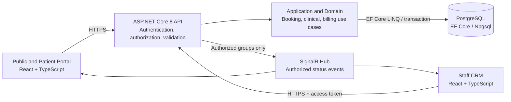
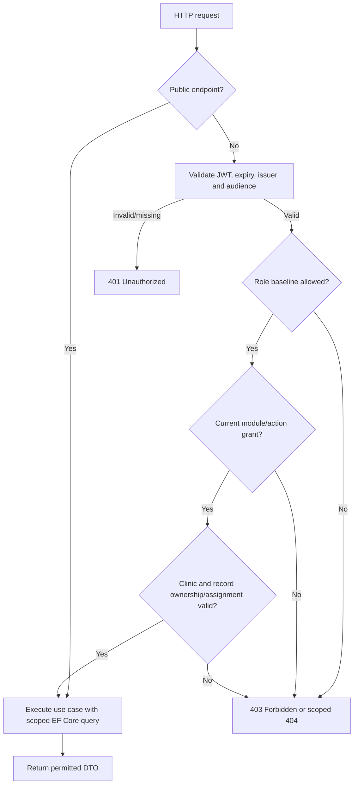
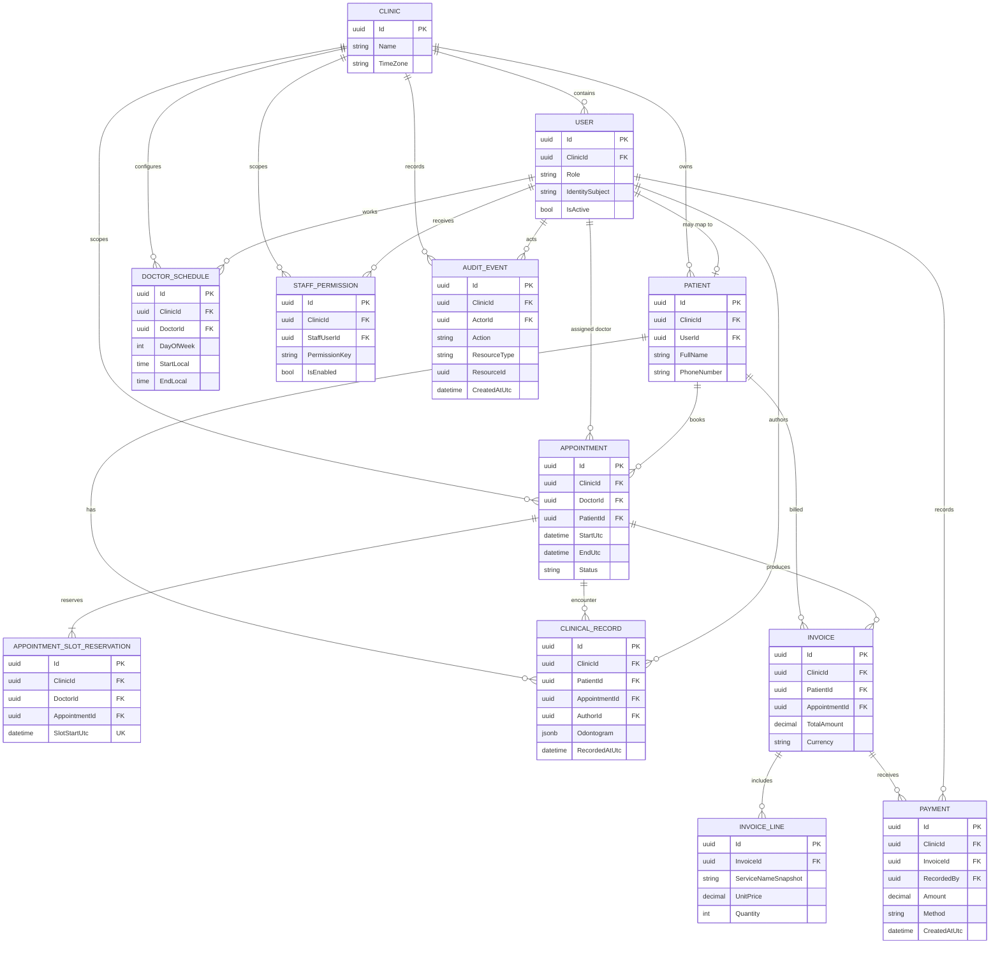
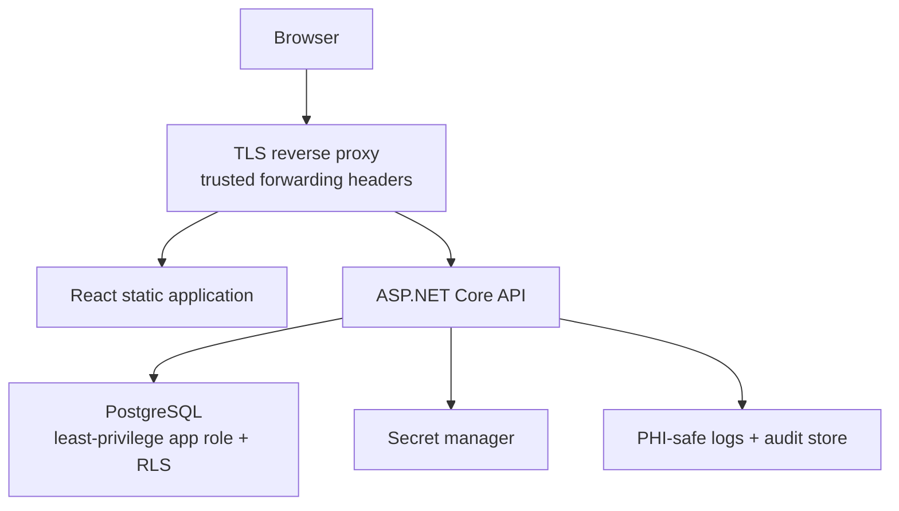

# DentaCore — Architecture Diagrams

All visual architecture, workflow, and entity relationship representations are kept in this file. Diagrams describe the target MVP; the current repository is a frontend-only prototype and does not yet implement the API/database shown below.

## 1. Target system context



## 2. Booking reservation flow

```mermaid
sequenceDiagram
  autonumber
  actor Patient as Portal user
  actor Reception as Receptionist
  participant API as Booking API
  participant DB as PostgreSQL
  par Patient booking request
    Patient->>API: POST booking + idempotency key
  and Reception desk booking request
    Reception->>API: POST booking + authenticated identity
  end
  API->>API: Validate identity/input, clinic, schedule, service and slot grid
  API->>DB: Begin transaction
  API->>DB: EF insert appointment and one reservation per occupied slot
  Note over DB: Unique (ClinicId, DoctorId, SlotStartUtc) index serializes conflicts
  alt Reservation transaction wins
    DB-->>API: Commit
    API-->>Patient: 201 Created / booking reference
    API-->>Reception: 201 Created / booking reference
  else Slot already reserved
    DB-->>API: Unique reservation conflict; rollback
    API-->>Patient: 409 Problem Details
    API-->>Reception: 409 Problem Details
  end
```

## 3. Authorization and data-scope flow



## 4. Core entities and relationships



The `APPOINTMENT_SLOT_RESERVATION` unique index must cover `(ClinicId, DoctorId, SlotStartUtc)`. The JSON odontogram shape needs a versioned schema and revision history; do not treat JSON storage as a substitute for authorization or audit.

## 5. MVP deployment boundary



Never expose PostgreSQL directly to browsers. The reverse proxy is the only trusted source for forwarded client IP and TLS termination metadata.
